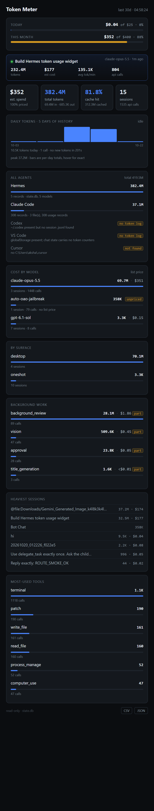

# token-meter

A local dashboard for what your AI coding agents are actually costing you.



I built this because I had no idea what my token bill was. My agent had burned
through 380 million tokens and every usage screen I could find either showed
`$0.00` or a number I couldn't verify. So this reads the data straight off
disk and prices it itself.

It's one Python file, no dependencies, no API keys, no account. Point it at
your machine and it tells you where the money went.

## What it does

- **Prices every request.** Reads the [models.dev](https://models.dev) catalog
  that's already on disk and applies per-model rates (input, output, cache
  read, cache write) to your actual token counts.
- **Refuses to guess.** If a model has no published price, it says `unpriced`
  and leaves it out of the total. It does not show `$0` for something it
  couldn't price, because `$0` is a claim, not a placeholder.
- **Tells you the coverage.** The spend tile shows what percentage of your
  tokens it could actually price. Right now that's 99.5% on my machine, and
  you can see the 0.5% it missed.
- **Covers multiple agents.** Hermes, Claude Code, and Codex are supported.
  It reads each one's own logs rather than asking them to cooperate.
- **Warns before you blow a budget.** Daily and monthly caps with a gauge and
  a one-shot alert per period.
- **Keeps history.** Session data gets pruned. The daily rollup lives in a
  separate SQLite file that doesn't.

## Install

Python 3.10+. Nothing else.

```bash
git clone https://github.com/wwwjnrbrs-beep/token-meter
cd token-meter
python token_meter.py
```

That starts a server on a free port and opens a Chrome app window at it. If
Chrome isn't around it falls back to your default browser.

```bash
python token_meter.py --no-open       # server only, don't open a window
python token_meter.py --days 7        # change the window
python token_meter.py --port 8766     # fixed port
```

Set a budget:

```bash
python token_meter.py --set-budget daily=25 monthly=400 alert=80
```

## Where the numbers come from

Nothing is scraped from a dashboard or an API. It's all read off local files.

**Hermes** — `state.db` in your Hermes home directory. Opened read-only
(`mode=ro`), so it can't corrupt anything.

**Claude Code** — `~/.claude/projects/*/*.jsonl`. One JSON object per line.
The records that matter look like this:

```json
{"type":"assistant","message":{
  "model":"claude-opus-4-5",
  "usage":{"input_tokens":1234,"output_tokens":567,
           "cache_read_input_tokens":8901,"cache_creation_input_tokens":0}}}
```

**Codex** — `~/.codex/sessions/**/*.jsonl`. The format has changed between
versions, so the parser checks for several known shapes and reports what it
couldn't read instead of assuming.

**Pricing** — `models_dev_cache.json`, also local. 4,103 models with rates.

## What it can't do

I'd rather write this down than let you find out the hard way.

- **Codex is unverified.** There are no Codex session logs on my machine, so
  the adapter has never seen a real one. It handles the formats I could find
  documented. If yours doesn't match, it'll say "no recognisable usage
  records" rather than inventing numbers.
- **VS Code and Cursor aren't supported.** Neither writes per-request token
  counts to disk. VS Code keeps conversation state, Cursor keeps usage
  server-side. The dashboard shows them as `unavailable` with a reason. If
  they showed `0` you'd think those agents were free.
- **Costs are list price.** If you're on a discount, a subscription, or
  enterprise pricing, your real bill will be lower. This is the "what would
  this have cost at retail" number.
- **Alerts only exist while the page is open.** There's no background daemon
  yet, so no desktop notification or webhook.
- **The Hermes desktop widget is unfinished.** The backend route works and
  returns 200. The status-bar chip never rendered and I haven't confirmed
  why. Use the standalone window.

## The zero-token trap

Worth knowing if you write your own parser. One of my Claude Code transcripts
was **77.8 MB with 60,067 assistant records and zero real tokens.** They're
streaming placeholders — the usage block is there, every field is `0`. The
actual data was 308 records in a different, much smaller file.

If you count every record with a `usage` key, you'll get a confident and
completely wrong answer. Filter zero-token blocks. It's also about 80x faster.

## Design notes

A few decisions that weren't obvious:

**Why SQLite over a JSON cache.** The store is already SQLite and the queries
are aggregations. Pulling rows into Python to sum them would be slower and
use more memory.

**Why one reused connection.** Opening a SQLite connection on Windows costs
about 5ms. The queries themselves run in about 1ms. With eight queries per
refresh, per-query connects made a 40ms payload take 236ms. Reusing the
connection took it to 47ms. This was the single biggest performance win and it
was entirely in the plumbing.

**Why the server refuses to share a port.** On Windows, `SO_REUSEADDR` lets
several processes bind the same port. I hit a bug where a stale server kept
answering alongside a new one, so the browser got a mix of old and new HTML
and my fixes appeared not to work. `SO_EXCLUSIVEADDRUSE` fixes it. A second
instance now exits with a message instead of silently fighting the first.

**Why the ledger is separate.** Hermes prunes old sessions. Cost history
shouldn't disappear because of that, so daily rollups go to
`token_meter_ledger.db`.

## Tests

```bash
python test_token_meter.py
```

46 tests, no pytest needed. They pin the invariants that matter: unknown
pricing returns `None` not `0`, sub-cent amounts don't round to zero,
pluralisation is right, the payload reconciles, unreadable agents contribute
nothing.

One of them caught a real bug while I was writing this: the model list was
sorted by cost but the bars were drawn by token count, so a 3.3K row sat above
a 358K one. The UI hid it by re-sorting. The data layer was wrong.

## Endpoints

| Path | What |
|---|---|
| `/` | The dashboard |
| `/health` | JSON health. 503 if it can't read its own store |
| `/export.csv` | Daily and per-model rows |
| `/export.json` | Same, structured |

## Status

Working and in daily use on my machine. Not packaged, not versioned, no CI.
The adapters are the fragile part — agent log formats change without notice,
and when they do this breaks quietly.

If you hit a format that doesn't parse, the `detail` string in the
`all agents` panel usually says which file it choked on.

## License

MIT
